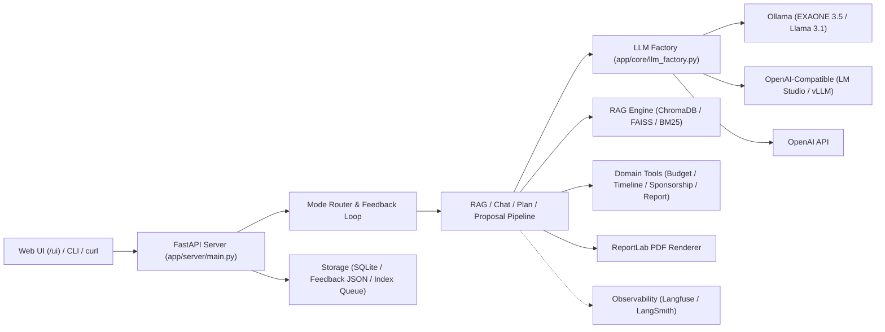

**Language:** [한국어](README.md) | [English](README.en.md)

# LangChain & LangGraph Catalog Lab

A comprehensive hands-on repository featuring **modular, standalone catalog demos**, **step-by-step lessons**, and a **production-ready E2E FastAPI AI Agent & Proposal Automation Server** built on LangChain v1, LangGraph, RAG, Guardrails, and Observability (Langfuse / LangSmith).


---

## Key Highlights

- **17 Modular Catalog Categories (`catalog/`)**: Standalone runnable demos covering Prompts, LCEL, Output Parsers, Structured Output, Memory, Tools, Agents, RAG, Routers, SQL, Callbacks, Guardrails, LangGraph, Monitoring, Performance, Ops, and Evaluation.
- **Structured Curriculum (`lessons/`)**: Sequential lessons from `00_healthcheck.py` through `14_langfuse_monitoring.py`.
- **Multi-Backend LLM Switching (`LLM Factory`)**: Seamlessly switch between **Ollama (EXAONE 3.5 / Llama 3.1)**, **OpenAI-compatible endpoints (LM Studio / vLLM)**, and **OpenAI** via `LLM_PROVIDER`.
- **E2E FastAPI Server & Web UI (`app/server/`)**:
  - Asynchronous **NDJSON streaming** (`/chat/stream` with 3s keepalive ping)
  - **Self-Query RAG**, **ChromaDB / FAISS / BM25 / Ensemble** retrieval
  - **HITL (Human-in-the-Loop)** approval workflow (`/approve`)
  - **Automated Proposal & PDF Pipeline**: Template normalization, section rewriting, citation enforcement, footnote mapping, consistency checking, and ReportLab A4 PDF export
  - **Feedback & Evaluation**: User feedback collection (`/feedback`, `/feedback/stats`) feeding into mode routing and evaluation metrics (`/eval`)
- **Dual Execution (Docker & Local)**: Runs identically inside Docker Compose (`/app`) and locally (`PROJECT_ROOT` auto-resolution) with a `pytest` suite.

---

## Tech Stack

| Layer | Technologies / Libraries | Details |
| :--- | :--- | :--- |
| **Core LLM Framework** | `langchain==1.2.10`, `langchain-core==1.2.13`, `langchain-community==0.4.1`, `langchain-openai==1.1.10`, `langchain-classic==1.0.1` | LCEL (`Runnable`), prompt templates, structured output, Self-Query chains |
| **Agent & Workflow** | `langgraph>=0.2.35` | Stateful graphs, conditional routing, SQLite checkpointing, subgraphs, HITL approval loops, parallel fan-out |
| **LLM Providers** | Ollama (`exaone3.5:2.4b`, `exaone3.5:7.8b`, `llama3.1:8b`, `nomic-embed-text`), OpenAI-compatible (LM Studio/vLLM), OpenAI (`gpt-4o-mini`) | Auto-detection & provider switching in `app/core/llm_factory.py` |
| **RAG & Vector Stores** | `chromadb>=0.5.5`, `faiss-cpu>=1.8.0`, `rank-bm25>=0.2.2`, `langchain-text-splitters>=1.1.0`, `lark>=1.1.9` | Persistent ChromaDB, FAISS index, BM25 lexical search, Ensemble / MMR / MultiQuery / Self-Query retrievers |
| **Document Loaders** | `pypdf>=4.2.0`, `unstructured>=0.15.7`, `tiktoken>=0.7.0` | PDF, Markdown, and text ingestion with token-aware chunking |
| **Backend API & Web UI** | `fastapi>=0.115.0`, `uvicorn[standard]>=0.30.0`, `pydantic>=2.6`, `python-multipart>=0.0.9` | REST API, NDJSON streaming, latency instrumentation middleware (`X-Process-Time-Ms`), static Web UI (`/ui`) |
| **PDF & Report Engine** | `reportlab>=4.0.0`, `pillow>=10.0.0` | Styled A4 PDF rendering from Markdown proposals with custom Korean font support |
| **Observability & Eval** | Langfuse, LangSmith (`LANGCHAIN_TRACING_V2`), Custom Eval | Tracing, cost tracking, prompt management, LLM-as-a-Judge & regression evaluation |
| **Storage & Ops** | SQLite, JSON/JSONL, Docker & Docker Compose (`python:3.11-slim`), `Makefile` | HITL action store, feedback/index queue, containerized reproducibility |
| **Testing** | `pytest` (`tests/`) | Unit & API integration tests for settings, LLM factory, domain tools, feedback/eval, and FastAPI routes |

---

## System Architecture



---

## Project Structure

```text
langchain-lab/
├── app/
│   ├── cli.py                  # CLI entry point
│   ├── core/
│   │   ├── settings.py         # Environment config & portable PROJECT_ROOT paths
│   │   ├── llm_factory.py      # Auto-switching for Ollama / OpenAI-compatible / OpenAI
│   │   ├── prompts.py          # Shared prompt templates
│   │   └── rag_utils.py        # Document ingestion, splitting, and Chroma vectorstore helpers
│   ├── server/
│   │   ├── main.py             # FastAPI app, /chat/stream, security/timing middleware, UI mount
│   │   ├── agent.py            # Routing, RAG/Chat/Plan execution & async streaming
│   │   ├── docs_api.py         # Document management endpoints
│   │   ├── self_query_api.py   # Self-Query RAG endpoints
│   │   ├── proposal_api.py     # Proposal generation, normalization, and PDF endpoints
│   │   ├── feedback.py & eval.py # User feedback persistence & evaluation reporting
│   │   └── static/             # Web UI static assets (/ui)
│   └── tools/                  # Domain tool schemas & implementations (budget, timeline, sponsorship, report)
├── catalog/                    # 17 standalone demo categories (see catalog/INDEX.md)
├── lessons/                    # Sequential learning scripts (00 to 14)
├── docs/                       # Feature docs (V8–V16) and curl test scripts
├── tests/                      # Pytest unit & FastAPI integration test suite
├── docker/Dockerfile           # Container image based on python:3.11-slim
├── docker-compose.yml          # Orchestration for lab & api services
├── Makefile                    # Shortcuts (up, down, demo, run-api, run-local, test)
├── requirements.txt            # Python dependencies
├── README.md                   # Korean README
└── README.en.md                # English README
```

---

## Quick Start

### 1. Configure Environment

```bash
cp .env.example .env
```

Choose your LLM backend in `.env`:

- **Ollama (Recommended — EXAONE 3.5 / Llama 3.1)**
  ```env
  LLM_PROVIDER=auto
  OLLAMA_BASE_URL=http://host.docker.internal:11434
  OLLAMA_MODEL=exaone3.5:2.4b
  OLLAMA_EMBED_MODEL=nomic-embed-text
  ```
- **OpenAI-compatible (LM Studio / vLLM)**
  ```env
  LLM_PROVIDER=openai_compatible
  OPENAI_COMPAT_BASE_URL=http://host.docker.internal:1234/v1
  OPENAI_COMPAT_API_KEY=lm-studio
  OPENAI_COMPAT_MODEL=gpt-4o-mini
  ```
- **OpenAI**
  ```env
  LLM_PROVIDER=openai
  OPENAI_API_KEY=YOUR_KEY
  OPENAI_MODEL=gpt-4o-mini
  ```

### 2. Run with Docker Compose

```bash
# Build and start services (Web UI available at http://localhost:8050/ui)
docker compose up --build

# Start API server only
make run-api

# Run an individual catalog demo
make demo D=catalog/prompts/01_prompt_templates.py
make demo D=catalog/langgraph/02_agentic_loop_graph.py

# Run CLI demo
make demo-cli
```

### 3. Run Locally & Execute Tests

```bash
# Start FastAPI server locally (http://localhost:8050/ui)
make run-local

# Run test suite
make test
```

---

## Key API Endpoints

| Method | Endpoint | Description |
| :--- | :--- | :--- |
| `GET` | `/health` | Service health, active provider, RAG flag, and version diagnostics |
| `POST` | `/chat` | Synchronous Q&A supporting `chat` / `rag` / `plan` modes and HITL |
| `POST` | `/chat/stream` | Async NDJSON streaming response with 3s keepalive pings |
| `POST` | `/approve` | Approve or reject and execute HITL pending actions |
| `GET` / `POST` | `/docs`, `/docs/upload`, `/docs/titles` | List documents, multi-file upload, and extract Markdown titles |
| `POST` | `/rag/self-query` | Extract metadata filters (`type`, `year`, `org`) and run filtered RAG |
| `POST` | `/tools/budget-split`, `/tools/timeline`, `/tools/sponsorship-package`, `/tools/report` | Campaign & business planning tool endpoints |
| `GET` / `POST` | `/artbiz/proposals`, `/artbiz/proposal/template`, `/artbiz/proposal/check` | Proposal version listing, template retrieval, and structure validation |
| `GET` / `POST` | `/feedback`, `/feedback/stats`, `/eval` | User feedback collection and satisfaction / RAG coverage evaluation |

---

## Catalog & Lessons Index

For the full catalog reference, see [catalog/INDEX.md](catalog/INDEX.md) and [docs/](docs/).

- **Foundations & LCEL**: `catalog/health/*`, `catalog/prompts/*`, `catalog/lcel/*`, `catalog/output/*`, `catalog/structured/*`
- **Tools & Agents**: `catalog/tools/*`, `catalog/agents/*`, `catalog/routers/*`, `catalog/memory/*`, `catalog/sql/*`
- **Advanced RAG**: `catalog/rag/*` (ChromaDB, FAISS, BM25, Ensemble, MMR, MultiQuery, Self-Query)
- **LangGraph**: `catalog/langgraph/*` (Minimal, Agentic Loop, Guarded, SQLite Checkpoint, Subgraph, Multi-role, HITL, Parallel Fan-out, ToolNode)
- **Reliability & Ops**: `catalog/guardrails/*`, `catalog/callbacks/*`, `catalog/monitoring/*` (Langfuse), `catalog/eval/*`, `catalog/perf/*`, `catalog/ops/*`
- **Lessons**: `lessons/00_healthcheck.py` – `lessons/14_langfuse_monitoring.py`
