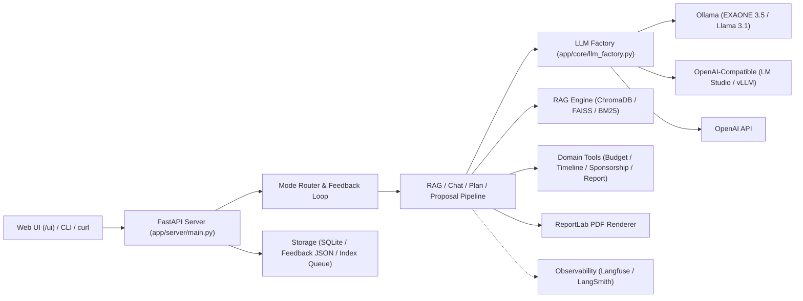

**Language:** [한국어](README.md) | [English](README.en.md)

# LangChain & LangGraph Catalog Lab

LangChain v1, LangGraph, RAG, 에이전트, 가드레일, 관측성(Langfuse/LangSmith), 그리고 **E2E FastAPI AI Agent 서버 및 제안서 자동화 파이프라인**까지 기능별 독립 데모와 실전 애플리케이션을 함께 담은 종합 실습 저장소입니다.


---

## 주요 특징

- **기능별 독립 카탈로그 (`catalog/`)**: Prompts, LCEL, Output Parsers, Structured Output, Memory, Tools, Agents, RAG, Routers, SQL, Callbacks, Guardrails, LangGraph, Monitoring, Eval 등 17개 영역 데모 제공
- **단계별 학습 레슨 (`lessons/`)**: `00_healthcheck.py`부터 `14_langfuse_monitoring.py`까지 순차 학습 커리큘럼
- **멀티 백엔드 LLM 스위칭 (`LLM Factory`)**: 단일 설정(`LLM_PROVIDER`)으로 **Ollama (EXAONE 3.5 / Llama 3.1)**, **OpenAI-호환(LM Studio / vLLM)**, **OpenAI** 간 즉시 전환
- **E2E FastAPI 서버 & Web UI (`app/server/`)**:
  - 비동기 **NDJSON 스트리밍**(`/chat/stream`, keepalive ping 포함)
  - **Self-Query RAG**, **ChromaDB / FAISS / BM25 / Ensemble** 검색
  - **HITL(Human-in-the-Loop)** 승인 워크플로우 (`/approve`)
  - **제안서(Proposal) 자동화 & PDF 렌더링**: 템플릿 정규화, 섹션 리라이팅, 인용(Citation) 강제, 각주 매핑, 정합성 검증, ReportLab PDF 출력
  - **피드백 & 평가 지표**: 사용자 피드백 수집(`/feedback`, `/feedback/stats`) 기반 라우팅 개선 및 평가 리포트(`/eval`)
- **Docker & 로컬 듀얼 실행 지원**: Docker Compose 기반 원클릭 실행과 로컬 Python/Uvicorn 실행(`PROJECT_ROOT` 자동 경로 해석) 모두 지원

---

## 기술 스택 (Tech Stack)

| 영역 | 기술 / 라이브러리 | 상세 설명 |
| :--- | :--- | :--- |
| **Core LLM Framework** | `langchain==1.2.10`, `langchain-core==1.2.13`, `langchain-community==0.4.1`, `langchain-openai==1.1.10`, `langchain-classic==1.0.1` | LCEL(`Runnable`), 프롬프트 체인, 구조화 출력, Self-Query 체인 |
| **Agent & Workflow** | `langgraph>=0.2.35` | 상태 기반 그래프, 조건부 라우팅, SQLite 체크포인트, 서브그래프, HITL 승인 루프, 병렬 Fan-out |
| **LLM Providers** | Ollama (`exaone3.5:2.4b`, `exaone3.5:7.8b`, `llama3.1:8b`, `nomic-embed-text`), OpenAI-compatible (LM Studio/vLLM), OpenAI (`gpt-4o-mini`) | `app/core/llm_factory.py`의 자동 헬스체크 및 프로바이더 스위칭 |
| **RAG & Vector DB** | `chromadb>=0.5.5`, `faiss-cpu>=1.8.0`, `rank-bm25>=0.2.2`, `langchain-text-splitters>=1.1.0`, `lark>=1.1.9` | ChromaDB 영속 벡터스토어, FAISS 인덱스, BM25 키워드 검색, Ensemble/MMR/MultiQuery/Self-Query Retriever |
| **Document Loaders** | `pypdf>=4.2.0`, `unstructured>=0.15.7`, `tiktoken>=0.7.0` | PDF/텍스트/마크다운 파싱 및 토큰 기반 청킹 |
| **Backend API & Web UI** | `fastapi>=0.115.0`, `uvicorn[standard]>=0.30.0`, `pydantic>=2.6`, `python-multipart>=0.0.9` | REST API, NDJSON 스트리밍, 요청 지연시간 계측 미들웨어(`X-Process-Time-Ms`), `/ui` 정적 웹 인터페이스 |
| **PDF & Report Engine** | `reportlab>=4.0.0`, `pillow>=10.0.0` | 제안서 마크다운 → 스타일링된 A4 PDF 변환 및 한글 폰트 지원 |
| **Observability & Eval** | Langfuse, LangSmith (`LANGCHAIN_TRACING_V2`), Custom Eval | 트레이싱, 비용 추적, 프롬프트 관리, LLM-as-a-Judge 기반 회귀 평가 |
| **Storage & Ops** | SQLite, JSON/JSONL, Docker & Docker Compose (`python:3.11-slim`), `Makefile` | HITL 액션 스토어, 피드백/인덱스 큐, 컨테이너 기반 재현성 |
| **Testing** | `pytest` (`tests/`) | 설정/팩토리, 비즈니스 툴, 피드백/평가, FastAPI 엔드포인트 단위 및 통합 테스트 |

---

## 시스템 아키텍처



---

## 프로젝트 구조

```text
langchain-lab/
├── app/
│   ├── cli.py                  # CLI 실행 진입점
│   ├── core/
│   │   ├── settings.py         # 환경변수 및 PROJECT_ROOT 기반 이식형 경로 설정
│   │   ├── llm_factory.py      # Ollama / OpenAI-compatible / OpenAI 자동 스위칭
│   │   ├── prompts.py          # 공통 프롬프트 템플릿
│   │   └── rag_utils.py        # 문서 수집, 청킹, Chroma 벡터스토어 유틸
│   ├── server/
│   │   ├── main.py             # FastAPI 앱, 스트리밍(/chat/stream), 보안/미들웨어, UI 마운트
│   │   ├── agent.py            # 라우팅, RAG/Chat/Plan 응답 및 스트리밍 생성
│   │   ├── docs_api.py         # 문서 관리 API
│   │   ├── self_query_api.py   # Self-Query RAG API
│   │   ├── proposal_api.py     # 제안서 생성/정규화/PDF API
│   │   ├── feedback.py & eval.py # 사용자 피드백 저장 및 평가 지표 리포트
│   │   └── static/             # Web UI 정적 파일 (/ui)
│   └── tools/                  # 예산 배분, 타임라인, 스폰서십, 리포트 툴 스키마/구현
├── catalog/                    # 17개 카테고리별 독립 실행 데모 (INDEX.md 참고)
├── lessons/                    # 00~14 단계별 학습 스크립트
├── docs/                       # 버전별 기능 문서(V8~V16) 및 curl 테스트 스크립트
├── tests/                      # Pytest 단위/API 테스트 스위트
├── docker/Dockerfile           # python:3.11-slim 기반 컨테이너 이미지
├── docker-compose.yml          # lab & api 서비스 오케스트레이션
├── Makefile                    # 단축 명령어 (up, down, demo, run-api, run-local, test)
├── requirements.txt            # Python 패키지 의존성
├── README.md                   # 한국어 README
└── README.en.md                # 영문 README
```

---

## 빠른 시작 (Quick Start)

### 1. 환경 변수 설정

```bash
cp .env.example .env
```

`.env` 파일에서 사용할 LLM 백엔드를 선택합니다.

- **Ollama (권장 — EXAONE 3.5 / Llama 3.1)**
  ```env
  LLM_PROVIDER=auto
  OLLAMA_BASE_URL=http://host.docker.internal:11434
  OLLAMA_MODEL=exaone3.5:2.4b
  OLLAMA_EMBED_MODEL=nomic-embed-text
  ```
- **OpenAI-호환 (LM Studio / vLLM 등)**
  ```env
  LLM_PROVIDER=openai_compatible
  OPENAI_COMPAT_BASE_URL=http://host.docker.internal:1234/v1
  OPENAI_COMPAT_API_KEY=lm-studio
  OPENAI_COMPAT_MODEL=gpt-4o-mini
  ```
- **OpenAI**
  ```env
  LLM_PROVIDER=openai
  OPENAI_API_KEY=YOUR_KEY
  OPENAI_MODEL=gpt-4o-mini
  ```

### 2. Docker Compose로 실행

```bash
# 전체 서비스 빌드 및 실행 (API: http://localhost:8050/ui)
docker compose up --build

# API 서버만 실행
make run-api

# 개별 카탈로그 데모 실행
make demo D=catalog/prompts/01_prompt_templates.py
make demo D=catalog/langgraph/02_agentic_loop_graph.py

# CLI 데모 실행
make demo-cli
```

### 3. 로컬 환경에서 직접 실행 & 테스트

```bash
# 의존성 설치 후 로컬 FastAPI 서버 실행 (http://localhost:8050/ui)
make run-local

# 테스트 실행
make test
```

---

## 주요 API 엔드포인트

| Method | Endpoint | 설명 |
| :--- | :--- | :--- |
| `GET` | `/health` | 서버 상태, 프로바이더, RAG 설정, 버전 진단 |
| `POST` | `/chat` | 동기 질의응답 (`chat` / `rag` / `plan` 모드 및 HITL 지원) |
| `POST` | `/chat/stream` | NDJSON 비동기 스트리밍 응답 (3초 keepalive ping 포함) |
| `POST` | `/approve` | HITL 대기 액션 승인/거절 및 실행 |
| `GET` / `POST` | `/docs`, `/docs/upload`, `/docs/titles` | RAG 문서 목록 조회, 다중 업로드, 제목 추출 |
| `POST` | `/rag/self-query` | 질의에서 메타데이터 필터(`type`, `year`, `org`) 자동 추출 후 검색 |
| `POST` | `/tools/budget-split`, `/tools/timeline`, `/tools/sponsorship-package`, `/tools/report` | 캠페인/비즈니스 도메인 툴 API |
| `GET` / `POST` | `/artbiz/proposals`, `/artbiz/proposal/template`, `/artbiz/proposal/check` | 제안서 버전 조회, 템플릿 제공, 구조 검증 |
| `GET` / `POST` | `/feedback`, `/feedback/stats`, `/eval` | 사용자 피드백 수집 및 만족도/RAG 커버리지 평가 리포트 |

---

## 카탈로그 & 레슨 인덱스

자세한 카탈로그 설명은 [catalog/INDEX.md](catalog/INDEX.md) 및 [docs/](docs/) 문서를 참고하세요.

- **기초 & LCEL**: `catalog/health/*`, `catalog/prompts/*`, `catalog/lcel/*`, `catalog/output/*`, `catalog/structured/*`
- **도구 & 에이전트**: `catalog/tools/*`, `catalog/agents/*`, `catalog/routers/*`, `catalog/memory/*`, `catalog/sql/*`
- **RAG 심화**: `catalog/rag/*` (ChromaDB, FAISS, BM25, Ensemble, MMR, MultiQuery, Self-Query)
- **LangGraph**: `catalog/langgraph/*` (Minimal, Agentic Loop, Guarded, SQLite Checkpoint, Subgraph, Multi-role, HITL, Parallel Fan-out, ToolNode)
- **신뢰성 & 운영**: `catalog/guardrails/*`, `catalog/callbacks/*`, `catalog/monitoring/*` (Langfuse), `catalog/eval/*`, `catalog/perf/*`, `catalog/ops/*`
- **단계별 레슨**: `lessons/00_healthcheck.py` ~ `lessons/14_langfuse_monitoring.py`
